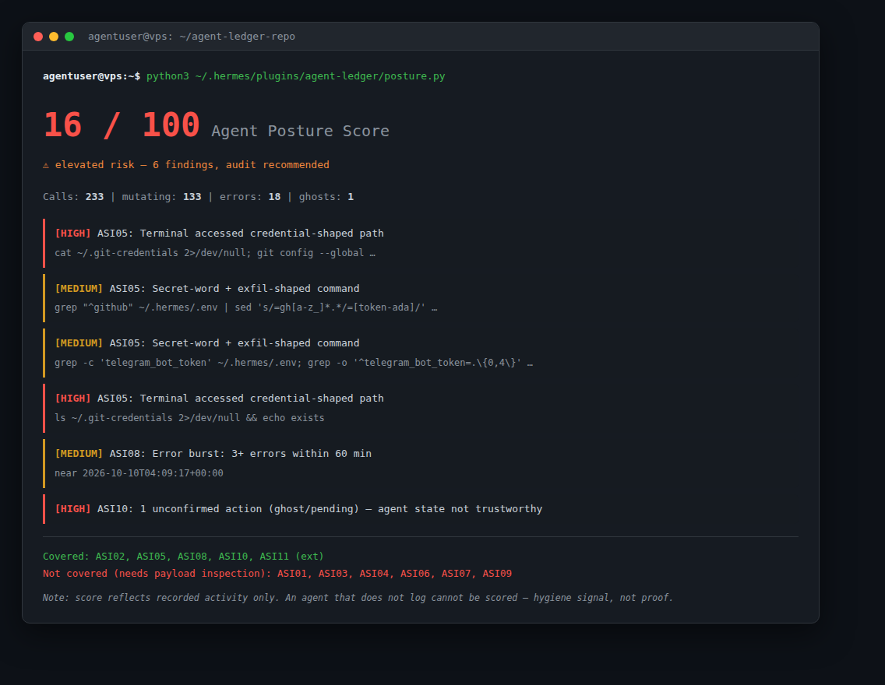

# agent-ledger

**Your agent said it did the job. Did it actually happen?**



agent-ledger is a Hermes Agent plugin that keeps a write-ahead ledger of every state-mutating tool call — so actions that were *issued* but never *confirmed* (silently lost, e.g. when context compaction tears down an in-flight turn) get caught, reported, and injected back into the agent's context on the next turn.

Inspired by [NousResearch/hermes-agent#90985](https://github.com/NousResearch/hermes-agent/issues/90985): a `cronjob_create` tool call was issued, compaction tore the turn down before the result was persisted, and the job **never existed** — no error, no retry, no trace. The agent believed it never happened. So did the user.

## How it works

```
pre_tool_call   → ledger entry PENDING   (tool, args, ts, session_id)
post_tool_call  → entry → CONFIRMED / ERROR:*
pre_llm_call    → reconcile: PENDING older than grace period = GHOST
                  → injected into the turn's context as a warning
```

- **Observer-only** — never blocks, never transforms. Writes are sub-10ms SQLite inserts (WAL mode) on a dedicated thread-safe connection.
- **Ghost detection** — a PENDING entry older than the grace period (2 min) is a candidate ghost: the call was issued but its effect was never confirmed.
- **Context injection** — ghosts surface in the *next* turn's context, so the agent itself is told: "verify whether this actually happened before trusting state."
- **Mutating-tool filter** — only tracks tools that change state (`write_file`, `patch`, `terminal`, `cronjob`, `delegate_task`, kanban mutations, all MCP tools via `mcp__` prefix). Read-only tools cost zero overhead.

## Install

```bash
mkdir -p ~/.hermes/plugins/agent-ledger
cd ~/.hermes/plugins/agent-ledger
# drop plugin.yaml + __init__.py here, or:
git clone https://github.com/ZidoCode/agent-ledger.git .
hermes plugins list          # should show agent-ledger
hermes plugins enable agent-ledger
hermes gateway restart       # plugin loads on the next session
```

## Inspecting the ledger

```bash
sqlite3 ~/.hermes/agent-ledger/ledger.db "
  SELECT ts, tool_name, status, substr(args_json,1,60)
  FROM ledger ORDER BY id DESC LIMIT 20;"
```

Statuses: `PENDING` → `CONFIRMED` | `ERROR:<type>` | `GHOST_REPORTED` (flagged and surfaced to the agent).

## Self-test

```bash
python3 selftest.py
# PASS: pending->confirmed via tool_call_id
# PASS: fallback confirm by tool name
# PASS: ghost detected
# PASS: context injection + GHOST_REPORTED
# PASS: mutating-tool filter
# PASS: hook signatures accept real fire-site kwargs
```

## Agent Posture (OWASP Agentic Top 10)

`posture.py` scores the recorded activity against the
[OWASP Top 10 for Agentic Applications 2026](https://genai.owasp.org/resource/owasp-top-10-for-agentic-applications-for-2026/).

```bash
python3 posture.py                          # score the live ledger
python3 -m posture ~/.hermes/agent-ledger/ledger.db
```

**Covered from ledger metadata:** ASI02 (tool misuse), ASI05 (unexpected code
execution), ASI08 (cascading failures), ASI10 (rogue agents), plus
**ASI11 `(ext)`** — *excessive agency*, a **community extension** (the official
OWASP list stops at ASI10) labeled as such everywhere.

**Not covered** (requires payload/conversation inspection, out of scope):
ASI01, ASI03, ASI04, ASI06, ASI07, ASI09.

**Scoring is auditable:** `score = 100 − Σ severity_weight(finding)`, with
`{CRITICAL:25, HIGH:15, MEDIUM:8, LOW:3}`; findings are not deduplicated. The
full finding list is always returned so you can recompute by hand.

**Trust model:** the ledger is written by the agent being scored. An agent that
doesn't log (or logs false entries) can't be scored by an observer — so a 100
means *"nothing suspicious in the recorded activity"*, **not** *"the agent was
well-behaved."* Treat it as a hygiene signal, not proof. (Tamper-evident
logging is a separate, harder problem.)

### Validation

| Suite | What it proves | Result |
|---|---|---|
| `test_posture.py` | ground truth: benign ledger → 100/no findings; malicious → all families | PASS |
| `test_posture_unit.py` | per-ASI must-fire + must-not-fire + **7 known evasions** | 36/36 |
| `test_posture_scale.py` | 10k rows / 50k rows + multi-session attribution | PASS (0.054s / 0.281s) |
| `selftest.py` | ledger FIFO matching, ghost reconcile | 13/13 |

**Known coverage limits:** these tests prove the scorer catches all **7
evasion patterns we know about** (base64|bash, `$HOME` indirection,
`rm -rf ./`, `rm -rf ~`, `wget|sh`, `chmod -R 777`, `git push -f`) and none
of the benign look-alikes. They do **not** prove immunity to novel evasions —
signature-based detection over ledger metadata is, by construction, a step
behind attacks nobody has written a rule for yet. Novel-evasion resistance
is an open problem; behavioral anomaly modeling (rate/baseline deltas) is
the mitigation we ship today, and it's why the score degrades on *any*
unusual mutating activity even without a matching signature.

```bash
python3 test_posture.py && python3 test_posture_unit.py \
  && python3 test_posture_scale.py && python3 selftest.py
```

### Daily audit

`posture_daily.py` runs on cron and sends a Telegram report (score + delta +
top findings, plus a dry-run policy section when a policy is installed).

## Policy enforcement (free, no license)

Everything in agent-ledger is free (MIT) — including **real enforcement**.
Observation is what the core does; enforcement is what happens when you
opt in:

1. Install a policy pack:

```bash
cp policy.example.json ~/.hermes/agent-ledger/policy.json
```

2. Watch the dry-run for a few days (blocks are only *logged*, your daily
   report shows what WOULD have been blocked):

```bash
echo dry_run > ~/.hermes/agent-ledger/policy_mode
```

3. Trust it:

```bash
echo enforce > ~/.hermes/agent-ledger/policy_mode
```

From then on, matching calls (`rm -rf ~`, `curl | bash`, credential reads,
force pushes, …) are **refused before they run**, with a clear reason fed
back to the agent.

If agent-ledger has saved your agent from something, a GitHub star and a
share are the best thank-you. If you want to support development, ping the
maintainer — but nothing here is gated.

## Design notes

- **Why pre_llm_call and not a background alert?** The hook can return `{"context": ...}` — injected into the current turn's user message without touching the (cache-sensitive) system prompt. The agent learns about the ghost *in the conversation where it can fix it*.
- **Why not block suspicious calls in pre_tool_call?** Hermes fails pre_tool_call hooks closed after a 30s timeout — a slow ledger would block legitimate tools. The ledger is a flight recorder, not a gate.
- **Why confirm-by-tool-name fallback?** Some fire paths don't carry `tool_call_id`; the fallback updates the most recent PENDING entry for that tool (safe under the write lock).
- Tested on Hermes Agent v0.21.3 (Linux VPS).

## Status

MVP, in daily use. Ghost-effect telemetry is being collected — real-world numbers will land in this README. Issues/PRs welcome.

## License

MIT
